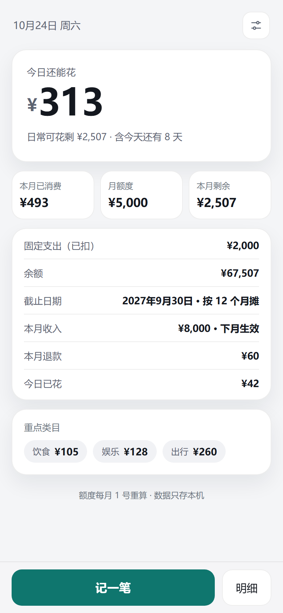
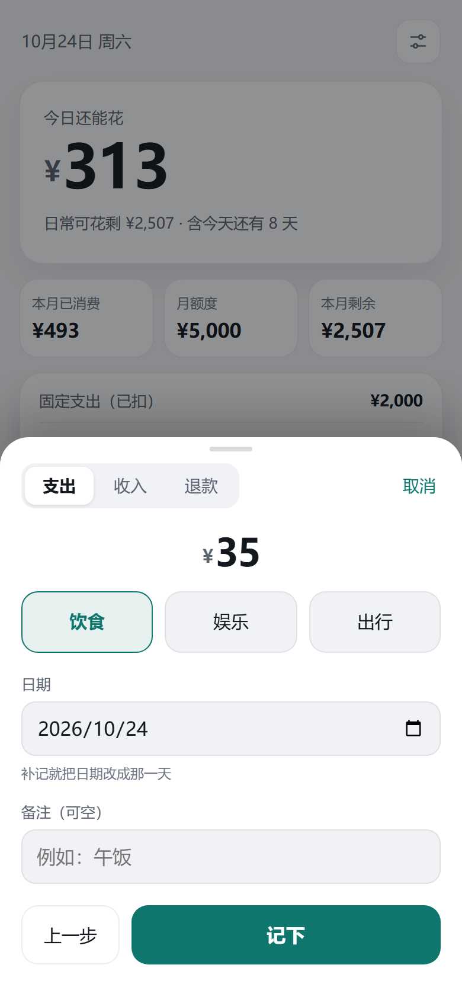

# 额度 · 今天还能花多少

一个**每日可花额度**的约束工具，不是账本。记账只是喂给它的输入。
打开 3 秒内看到"今天还能花多少"，其余数字都是解释。

- 依据：《记账工具-需求说明 v0.2》《记账工具-决策记录 v1》
- 形态：PWA，手机为主，数据只存本机
- 技术栈：Vite + 原生 JS + vite-plugin-pwa + localStorage + Vitest（决策 D19）



## 在电脑上打开

**最简单：双击项目根目录的 `启动记账工具.bat`。**
它会启动本地服务并自动打开浏览器，窗口不要关（关了服务就停）。

- 电脑：<http://localhost:4173/>
- 手机：窗口里 `Network:` 那一行（见下一节）

也可以走命令行：

```bash
pnpm install
pnpm dev        # 开发模式，改代码自动刷新，默认 5173
pnpm test       # 单元测试
pnpm build      # 产物在 dist/
pnpm preview    # 预览构建产物
```

> 不能直接双击 `index.html`：浏览器不允许 `file://` 页面加载 ES 模块，必须经过本地服务——bat 做的就是这件事。

首次打开会要求填三件事：当前余额、截止日期、每月固定支出（可空）。
数据存在 `localStorage` 的 `daily-quota-ledger.v1` 下，不联网、无账号。

## 手机上试用（局域网，不联网）

1. 电脑和手机连**同一个 Wi-Fi**。
2. 双击 `启动记账工具.bat`，记下窗口里 `Network: http://192.168.x.x:4173/`。
3. 手机浏览器打开这个地址。
4. 第一次运行 Windows 可能弹防火墙提示，选“允许访问（专用网络）”。

注意：这是 HTTP，只能试用。**离线缓存和“添加到主屏幕”需要 HTTPS**，所以正式使用请部署到 GitHub Pages（下一步）。

## 额度怎么算

```
每月 1 号（打开时惰性触发）：
  剩余月份   = 当月到截止日期的月份数（含当月）
  月额度     = 当月 1 号的余额 ÷ 剩余月份
  本月日常可花 = 月额度 − 固定支出

月内每天：
  日额度 = (本月日常可花 − 本月已消费) ÷ 本月剩余天数（含今天）

余额 = 起始余额 + 收入 − 支出 + 退款
```

与需求 §2.4 的示例一致（`test/calc.test.js` 把它钉成了测试）：

| 时间 | 计算 | 结果 |
|---|---|---|
| 2026-10-01 | 60000 ÷ 12 | 月额度 5000，日额度 5000 ÷ 31 ≈ 161 |
| 2026-10-10 | 已花 1200，剩 3800，剩 22 天 | 日额度 173 |
| 11-01 | 60000 − 4000 + 8000 = 64000，÷ 11 | 月额度 5818 |

### 三条必须记住的语义

1. **总额是余额，不是上限**（D5）。收入加、支出减；余额会持续下降，所以要偶尔"核对"。
2. **额度在月内是常数**（D7）。收入、补记、改设置都不改本月数字，只影响下月 1 号的重算结果。
3. **跨月靠打开时检测**（D21）。PWA 没有可靠的定时任务，所以没有"每月 1 号凌晨跑一次"。

## v1 范围

- [x] 首次设置：余额、截止日期、固定支出项
- [x] 首页：今日还能花、本月已消费 / 月额度、本月剩余、余额、重点类目金额
- [x] 记一笔：金额 → 类目两步；可补记日期；收入、退款/报销同入口
- [x] 导出 / 导入 JSON；超过 7 天未备份提醒

顺带做了（不做会明显影响可用性）：

- 本月明细与删除（两段确认）、今日已花
- 深色模式、桌面居中布局、PWA 安装与离线缓存
- 额度修改频率限制（D11）：余额与类目共用"每月 1 次"，首次不计



## 决策落地对照

| 决策 | 落地位置 |
|---|---|
| D1 额度工具非账本 | 首页只有一个主数字；明细只服务纠错 |
| D2 单用户 / Android / 纯本地 | 无登录、无网络请求；`localStorage` |
| D3 总额 + 重点类目（子集） | `config.categories`，类目只统计，不单独限额 |
| D4 两层摊销 | `calc.js` `createMonthState` + `computeView` |
| D5 余额型总额 | `calc.js` `balanceOf` |
| D6 自定义截止日期 | `config.deadline` + `remainingMonths` |
| D7 收入当月不动额度 | 月额度快照，月内冻结 |
| D8 固定支出单独池 | 快照里 `fixedTotal`，从月额度先扣 |
| D9 取消结转上限 | 不实现结转；钱留在余额里自然摊 |
| D10 大额不做特殊处理 | 余额下降 → 下月重算自动摊薄 |
| D11 额度每月改 1 次 | `quotaEditAllowed` + `config.quotaEdit` |
| D12 首页显示 | `homeHtml` / `heroHtml` / `statsHtml` / `metaHtml` |
| D13 手工两步 | `entryStep1Html` → `entryStep2Html` |
| D14 只存本机 + 手动备份 + 7 天提醒 | `store.js` + `bannerHtml` |
| D15 不做通知 | 无任何定时器 / 推送 |
| D16 按发生日、可补记 | 记录自带 `date`，额度按 `monthKeyOf(date)` 归月 |
| D17 退款冲减 | `type: 'refund'`，`spendDeltaCents` 为负 |
| D18 预设 + 可自增、无二级 | 类目是字符串数组，设置里可增删 |
| D19 技术栈 | `package.json` / `vite.config.js` |
| D20 计算集中、单 render | `calc.js` 全纯函数；`main.js` 一个 `render()` |
| D21 惰性跨月 | `ensureMonth`，在加载、`focus`、`visibilitychange` 时检查 |
| D22 备份文件名带日期 | `buildBackupFilename` → `额度备份-2026-10-24.json` |

## 实现时做的判断（需要你确认）

决策记录没写到这一层，以下是实现时补的细节：

1. **设置里的"余额"是当前余额，不是起始余额。**
   用户核对的是钱包/银行里的真实余额，所以保存时反推起始余额，首页立刻显示他填的数；
   但本月额度仍冻结，下月 1 号才按新余额重算。标注了"起始余额"，避免对不上账。

2. **月额度快照在跨月时创建，月内不可变。**
   包括改截止日期、改固定支出项，都只影响下月。唯一例外：截止日期过期导致算不出额度时，修好后当次立刻补算。

3. **D11 的"每月 1 次"只约束余额与类目。**
   截止日期、固定支出项不受次数限制（它们不改"额度"本身，只是参数），但同样次月生效。

4. **首页三个数字是"已消费 / 月额度 / 本月剩余"，固定支出单独一行。**
   若把固定支出藏起来，`5000 − 493 ≠ 2507` 会让人以为算错；单独一行 `固定支出（已扣）` 才好对账。

5. **月额度四舍五入到分，日额度显示时四舍五入到整元。**
   内部计算用分，展示用整元（需求示例也是 161 / 173 这种整数）。

6. **超支时主数字换成"本月已超支 ¥X"**，X 是超出"本月日常可花"的部分；"本月剩余"显示为负数（`−¥993`），不再出现正数剩余。

7. **明细只显示本月**，不做历史检索（非目标）。删除后本月数字立刻变，月额度仍到下月才变。

8. **退款/报销用 `refund` 类型**（金额仍为正），冲减当月已消费和对应类目；**收入**不带类目。

## 数据格式

```jsonc
{
  "version": 1,
  "config": {
    "createdAt": "2026-08-01T02:00:00.000Z",
    "setupDone": true,
    "initialBalance": 60000,   // 起始余额，不是当前余额
    "deadline": "2027-09-30",
    "categories": ["饮食", "娱乐", "出行"],
    "fixedExpenses": [{ "name": "房租", "amount": 2000 }],
    "quotaEdit": { "month": "2026-10", "at": "..." },
    "lastBackupAt": "2026-10-24T02:00:00.000Z"
  },
  "monthState": {                // 当月额度快照，跨月时重建
    "month": "2026-10",
    "baseBalance": 60000,        // 当月 1 号的余额
    "months": 12,
    "quota": 5000,
    "fixedTotal": 2000,
    "frozenAt": "..."
  },
  "txs": [
    { "id": "a1", "type": "expense", "amount": 35, "category": "饮食",
      "note": "午饭", "date": "2026-10-24", "ts": "..." }
  ]
}
```

`type` 取值：`expense`（支出）、`income`（收入）、`refund`（退款/报销）。

备份文件是 `{ app, version, exportedAt, data }` 包装的同一份 state，文件名 `额度备份-YYYY-MM-DD.json`。
导入时会校验应用标识、逐条清洗记录（坏日期、非正金额直接丢弃），旧版本备份尽量兼容。

## 发布到 GitHub Pages（手机正式用）

前提：有一个 GitHub 账号。仓库用**公开（Public）**，免费版 Pages 才可用。

### 方式 A：GitHub Desktop（不碰命令行，推荐）

1. 安装 <https://desktop.github.com/> 并登录 GitHub 账号。
2. `File` → `Add local repository…` → 选 `D:\记账工具` → 提示不是 git 仓库时点 **create a repository**。
3. 左下角 Summary 填 `v1`，点 **Commit to main**。
4. 右上角 **Publish repository**，取消勾选 “Keep this code private”，点 Publish。
5. 打开 `https://github.com/<用户名>/<仓库名>` → `Settings` → `Pages` → Source 选 **GitHub Actions**（第一次通常会自动启用，见下方说明）。
6. 点 `Actions` 标签，等 “Deploy to GitHub Pages” 变成绿色（约 1 分钟）。
7. 手机打开 `https://<用户名>.github.io/<仓库名>/`。

### 方式 B：命令行（装了 Git 之后）

```bash
cd /d D:\记账工具
git init
git add .
git commit -m "v1"
git branch -M main
git remote add origin https://github.com/<用户名>/<仓库名>.git
git push -u origin main
```

其余步骤同方式 A 的第 5–7 步。

### 方式 C：网页上传（什么都不装）

1. GitHub 建一个空仓库（不要勾 README / .gitignore）。
2. 仓库页 → `Add file` → `Upload files`，把项目里**除 `node_modules`、`dist` 之外**的所有文件和文件夹拖进去。
3. `.github` 是隐藏文件夹（资源管理器里勾“显示隐藏的项目”）；漏了它就没有自动部署，需要在仓库里手动新建 `.github/workflows/deploy.yml`。

> 仓库里请不要提交 `node_modules` 和 `dist`：`.gitignore` 已经排除了，Actions 会在云端自己装依赖、跑测试、构建。

### 手机安装

用 Chrome 打开 Pages 地址 → 右上角 `⋮` → **安装应用 / 添加到主屏幕**。之后像 App 一样全屏打开，离线也能看。

### 常见问题

- **Actions 失败**：先确认 `Settings → Pages → Source` 是 GitHub Actions，然后在 Actions 里对该次运行点 **Re-run all jobs**。
- **页面 404**：等 Actions 变绿；地址必须是 `https://<用户名>.github.io/<仓库名>/`，注意末尾斜杠。
- **端口被占用**：关掉之前那个黑色命令行窗口，再双击 bat。
- **手机打不开局域网地址**：确认同一 Wi-Fi、防火墙允许 Node.js、路由器没开“AP 隔离”。
- **换地址数据不见了**：数据按网址隔离存在浏览器里。localhost 的账目不会自动出现在 Pages 上——先在旧地址“导出 JSON”，到新地址“导入 JSON”。这是 D14 纯本地的必然结果。

## 测试

- `test/calc.test.js`：35 个用例，覆盖模型（含需求 §2.4 的三个数字、自稳性、闰年、退款、超支、截止日期过期、跨月、D11）
- `test/store.test.js`：12 个用例，覆盖数据清洗、导入校验、备份文件名
- 另外用 headless Chrome 跑过 34 项端到端自检（记账、补记、收入、退款、删除、额度冻结、D11、超支、跨月、备份提醒、无 JS 报错）

```bash
pnpm test
```

## 已知限制（都是决策里接受的代价）

- **漏记会让额度虚高**：所有额度都依赖"已消费"的准确性，v1 只能靠补记兜底（决策 D13 的最大风险）。
- **清浏览器数据 = 丢全部账目**：纯本地存储的固有属性，只能靠导出备份（D14）。
- **换机靠导入**：没有同步，也没有云端账号。
- **没有通知**（D15）：不会主动提醒你花钱或备份，只有打开时看到提醒条。
- **手填**：不识别银行/支付宝/微信流水（无开放接口）。

## 目录

```
启动记账工具.bat      双击启动本地服务（电脑 / 手机局域网试用）
index.html            页面骨架（PWA meta）
src/main.js           单 render()、事件委托、所有界面
src/calc.js           额度模型，纯函数
src/store.js          localStorage 与备份文件
src/style.css         移动优先样式，含深色模式
test/                 单元测试
scripts/make_icons.py 生成 PWA 图标（需要 Pillow）
public/               图标
docs/                 截图
.github/workflows/    GitHub Pages 部署
```
